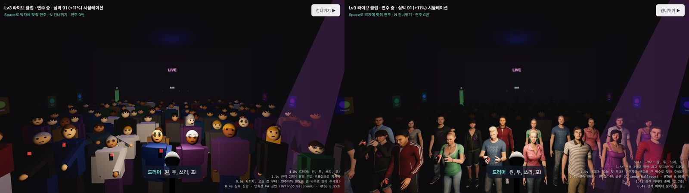
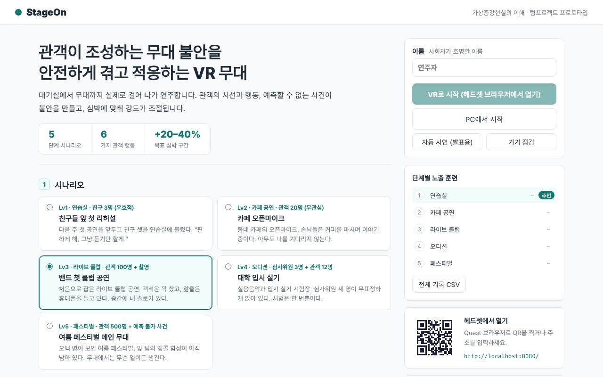
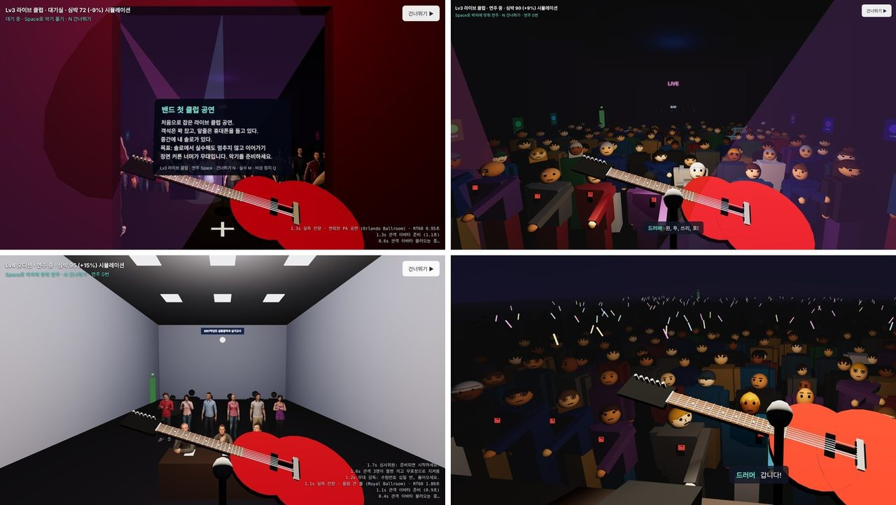
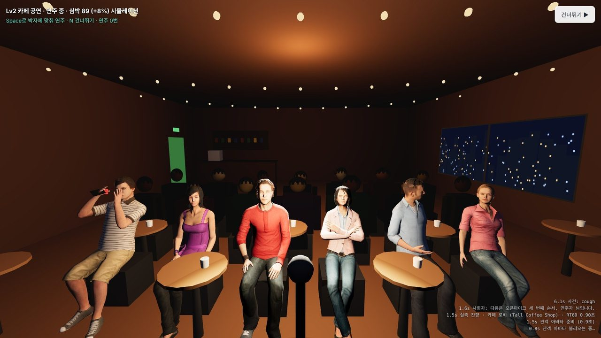
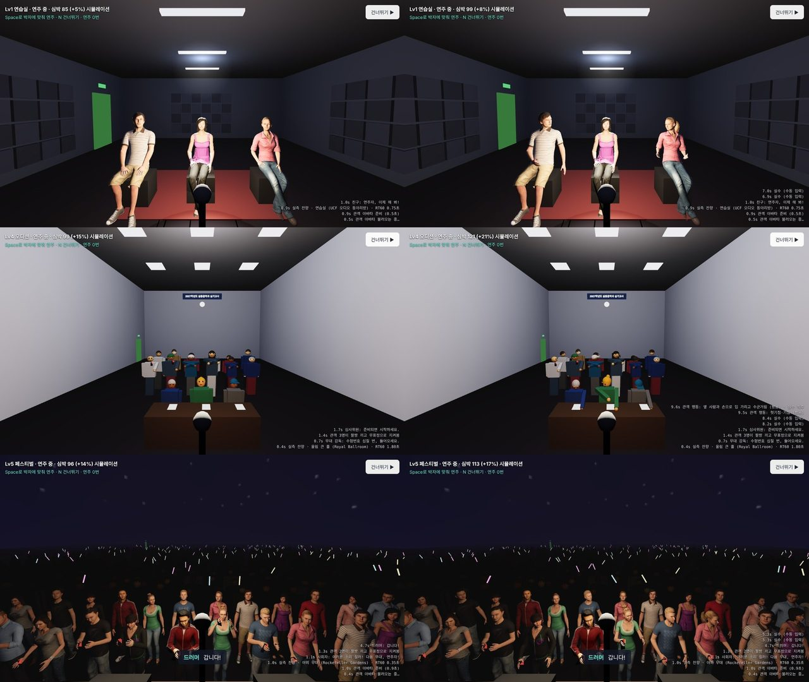
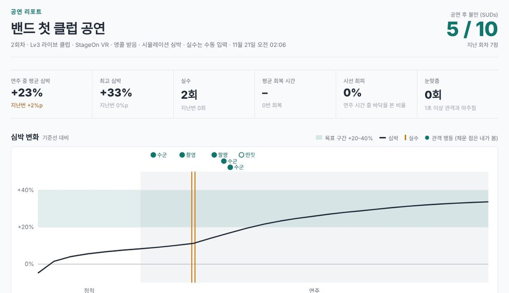
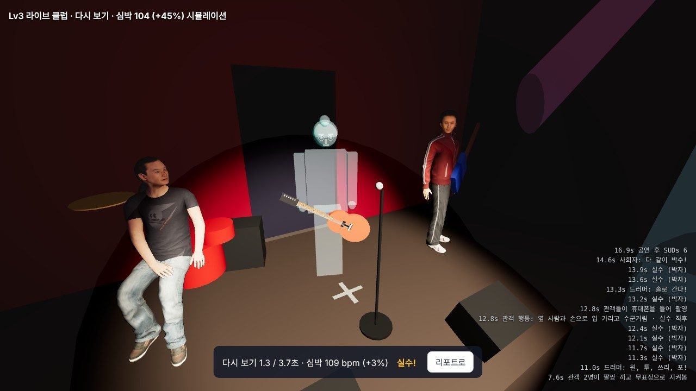
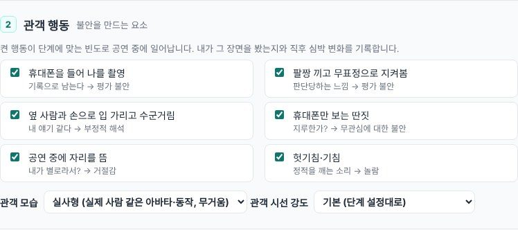

# StageOn 프로토타입

관객이 조성하는 무대 불안을 안전하게 겪고 적응하는 VR 무대 시뮬레이터입니다.
가상증강현실의 이해 텀프로젝트(박서현, 송민지, 조영찬)의 프로토타입입니다.

WebXR로 만들어 **Meta Quest 3 브라우저에서 링크만 열면 바로 실행**되고, PC 브라우저에서도 시험할 수 있습니다. 설치나 빌드 과정은 없습니다.


<sub>같은 Lv3 클럽 장면 · 왼쪽: 기본 관객(가벼움) · 오른쪽: 실사형 관객(실제 사람 같은 아바타와 모션캡처 동작)</sub>

## 화면 둘러보기

| 시작 화면 | 공연 하루 |
|---|---|
|  |  |
| 시나리오·관객 행동·관객 모습을 고르고, 단계별 훈련 진행과 헤드셋 접속 QR을 봅니다 | 대기실 → 클럽 → 입시 실기 → 페스티벌 (대기실·입시 실기는 실사형, 클럽·페스티벌은 기본 관객) |
| **관객 행동** | **실수 직후 관객 반응** |
|  |  |
| 가운데 팔짱 끼고 무표정, 왼쪽 휴대폰 촬영(빨간 불), 오른쪽 수군거림 | 왼쪽: 실수 전, 오른쪽: 실수 직후 고개를 돌리고 표정이 바뀜 |
| **공연 리포트** | **관객 시점 다시 보기** |
|  |  |
| 불안 점수, 지난 회차와 비교한 수치, 실수·관객 행동이 표시된 심박 그래프 | 객석에서 과거의 나를 봅니다 (시선 회피·실수 순간 표시) |

## 실행

### Quest 3
1. 이 저장소의 GitHub Pages를 켭니다: Settings → Pages → Branch `main` / `/ (root)` → Save.
2. 헤드셋 브라우저에서 `https://<계정>.github.io/<저장소>/`를 엽니다.
3. 시나리오를 고르고 **VR로 시작**을 누릅니다.
4. 헤드셋을 쓴 자리가 대기실입니다. 호명되면 **정면으로 약 2.2m 실제로 걸어 나가** 노란 표시에 섭니다. 앞쪽 공간을 비워 두세요. 공간이 좁으면 B 버튼(손 추적: 오른손 집기 2초)으로 걷지 않고 이동합니다.

### PC
```bash
python3 -m http.server 8080
# http://localhost:8080 접속 → "PC에서 시작"
```
`?fast=1`을 붙이면 대기실 6초, 곡 최대 12마디로 짧아집니다 (시연용).

| 조작 | PC | Quest 3 |
|---|---|---|
| 보기 / 이동 | 화면 클릭 후 마우스, W/A/S/D | 머리와 실제 걸음 |
| 악기 연주 (박자에 맞춰) | Space | 오른손 트리거 |
| 악기 위치 맞춤 (대기실) | – | 오른손 트리거 (노란 윤곽이 보일 때) |
| 건너뛰기 (대기·입장·연주) | N 또는 화면의 ‘건너뛰기’ | 오른손 B 버튼 |
| 실수 입력 (시연) | M | 오른손 그립 |
| 시뮬레이션 심박 조절 | ↑ / ↓ | 오른손 스틱 위/아래 |
| 주관적 불안 (SUDs 0–9) | 숫자 키 | – |
| 대기 건너뛰기 | Enter | – |
| 상세 정보 | G | – |
| 비상 정지 | Q | 왼손 X 버튼 |
| 리포트에서 다시 하기 | 버튼 | 오른손 A 버튼 |

**손 추적(컨트롤러 없이):** 가상 악기가 몸 앞에 놓이고, 오른손 검지로 몸통 근처를 빠르게 아래로 긁으면 연주됩니다. 엄지와 검지를 집은 채로 **왼손 2초 = 비상 정지**, **오른손 2초 = 건너뛰기**. 불안 점수는 오른손 집기 +1, 왼손 집기 −1, 양손 1초 집기로 확정합니다.

## 시나리오
같은 단계라도 이야기가 있어야 불안이 생깁니다 (몰입감 Plot). 각 시나리오는 대기실 대사 → 호명 → 노래 중 정해진 마디의 사건 → 마무리 멘트로 이어지고, 한 곡은 30–50초입니다.

| 시나리오 | 단계 | 이야기 | 노래 중 사건 |
|---|---|---|---|
| 친구들 앞 첫 리허설 | Lv1 | 첫 공연 전 친구 셋 앞에서 연습 | 친구 반응, 박수 따라치기 |
| 카페 오픈마이크 | Lv2 | 이야기하느라 아무도 나를 보지 않는 손님들 | 기침, 휴대폰 벨, 수다, 손님들이 하나둘 돌아봄 |
| 밴드 첫 클럽 공연 | Lv3 | 꽉 찬 객석, 중간에 내 솔로 | 촬영 증가, **솔로**(조명이 좁아지고 반주가 물러남), 모니터 소리 작아짐, 박수 따라치기, **앵콜** |
| 대학 입시 실기 | Lv4 | 무표정한 심사위원 셋, 기회는 한 번 | 심사위원이 연주를 **중간에 끊고 다시 시키기** |
| 여름 페스티벌 메인 무대 | Lv5 | 오백 명, 무슨 일이든 생김 | 모니터 사고, 솔로, 조명 깜빡임, 박수 따라치기, **앵콜** |

공연장도 시나리오마다 다르게 꾸몄습니다 (Vividness, Stable Spatial Place): 연습실은 방음 스펀지 벽과 형광등, 카페는 나무 바닥·테이블·전구 줄·창밖 밤거리, 클럽은 네온사인·바·포스터·움직이는 색 조명과 연기, 입시 실기는 하얀 강당·천장 조명·벽시계·수험번호, 페스티벌은 밤하늘 야외 무대·조명 트러스·대형 스크린·흔들리는 응원봉입니다.

앵콜은 실수가 적어 박수가 충분히 클 때만 나옵니다. 말은 음성과 자막으로 함께 나오고, 시나리오 내용은 `src/config.js`의 `SCENARIOS`에서 바꿀 수 있습니다.

## 악기
일렉 기타와 베이스 중에서 고릅니다. 가상 악기는 실물 악기 위에 겹쳐 보이도록 만들었습니다 (보고서 2-5, 4-2).
- **VR:** 왼손 컨트롤러를 악기 헤드에 달면(마운트) 가상 악기가 그 컨트롤러를 따라갑니다. 대기실에서 노란 윤곽(교정 가이드)이 보일 때 실물 악기를 연주 자세로 들고 오른손 트리거를 누르면, 헤드는 컨트롤러 위치, 몸통은 허리 앞에 오도록 위치를 맞춥니다.
- **PC:** 1인칭으로 몸 앞에 든 기타가 보입니다. 아래를 보면 지판이 보입니다.
- **연주:** 트리거나 Space를 누르면 반주와 같은 코드(E–A–G)로 스트럼 소리가 무대 뒤 앰프에서 공연장 잔향과 함께 나고, 줄이 빛납니다. 누른 시점이 16분음표 박자 격자에서 50ms 이상 두 번 어긋나면 실수로 판단해 관객이 반응합니다. 3초 이상 멈추면 정적으로 판단합니다.
- 실제 악기 소리를 쓰려면 ‘악기 소리 입력’을 켜고 오디오 인터페이스를 연결하세요. 같은 방식으로 박자를 판정합니다.

## 보고서와 구현의 대응

| 보고서 | 구현 | 파일 |
|---|---|---|
| E1 나를 보는 관객 | 앞줄 응시 비율(단계별 50–80%), 각자 2–5초마다 시선 이동, 1초 이상 바라보면 0.5초 안에 눈맞춤과 표정 변화, 시선을 3초 이상 피하면 앞줄이 고개를 기울여 눈을 찾음 | `figures.js`, `main.js` `gazeTracking` |
| E2 나를 평가하는 사람 | 오디션 단계의 심사위원 3명(무표정, 실수 시 메모·시계 확인 + 펜 소리), 휴대폰 촬영(빨간 불), 아는 얼굴 사진 | `venue.js`, `main.js` `onMistake`, `applyPhoto` |
| E3 실수에 반응하는 공연장 | 박자 오차 50ms 이상(한 마디 안 2회)을 실수로 판단, 관객마다 0.3–1.5초 지연으로 앞줄부터 술렁임, 웅성 소리는 그 관객 위치에서(HRTF), 밴드 멤버가 돌아봄 | `director.js` `TimingJudge`, `reactionDelay` |
| E4 멈출 수 없는 공연 | 일시정지 없음, 반주 밴드는 계속 진행, 정적 3초 → 술렁임, 무대 감독 시간 큐, 예측 불가 사건(휴대폰 벨, 모니터 소리 작아짐, 늦게 온 관객, 기침, 조명 깜빡임) | `main.js` `randomEvent`, `audio.js` |
| E5 내 긴장을 되비추는 무대 | 심박이 기준선 +30% 이상이면 심박에 맞춰 박동음 + 컨트롤러 진동, 실수 직전 심박 수준(+5%p 이내)으로 돌아와 4마디 이어가면 회복 → 관객 재집중·박수 | `director.js` `RecoveryTracker` |
| 4-3 불안 조절 엔진 | 15초 이동 평균 심박이 목표 구간 +20–40%보다 10초 낮으면 장치 추가, +50%가 15초 지속되거나 SUDs 8 이상이면 완화 모드(관객 우호적, 객석 조명 밝게) | `director.js` `StressorDirector` |
| 운동감 | 가상 이동 없이 실제로 걸어서 대기실 → 무대 입장 | `venue.js` `STAGE` |
| 실사형 관객 (선택) | 시작 화면의 ‘관객 모습’에서 고름(기본값은 단순한 인물). 앞줄 관객·심사위원·밴드는 Microsoft Rocketbox 실사 아바타(표정 블렌드셰이프)와 모션캡처 동작(박수·환호·촬영·수군거림·하품·기침·걷기), 시선은 머리 뼈, 표정·눈 깜빡임은 블렌드셰이프, 팔짱은 팔 뼈 방향으로 덧입힘. 중간·뒷줄은 어두운 실루엣 | `avatars.js`, `assets/avatars/` |
| 관객 관심도 | 관객마다 관심도(0–1)가 있어 실수하면 앞줄부터 식고, 실수 없이 이어 가거나 눈을 맞추면 오름. 관심도가 높으면 박자에 맞춰 고개를 끄덕이고, 낮으면 하품·두리번거림이 잦아짐. 수군거림은 옆 사람에게 번짐 | `main.js` `updateEngagement`, `figures.js` |
| 공간·잔향 | 무대마다 실제 공간에서 측정한 임펄스 응답(IR)으로 잔향 (합성 잔향·내 IR 파일로 바꿀 수 있음), 내 악기 소리에도 잔향만 덧입힘 | `audio.js` `loadImpulse`, `acoustics.js`, `assets/ir/` |
| 눈부심·눈 적응 | 스포트라이트를 볼수록 빛 번짐, 조명이 켜질 때 노출이 1–2초에 걸쳐 적응 | `main.js` `step` |
| Vividness · LOD | 앞줄은 표정이 움직이는 고품질, 중간 줄은 머리만 움직이는 저품질, 뒷줄 군중은 InstancedMesh 한 번의 그리기 | `figures.js` |

## 실험 설정과 훈련 보조
시작 화면의 ‘실험 설정 · 훈련 보조’에서 고릅니다.
- **단서 끄기 (실험 B):** E1 시선, E2 평가, E3 실수 반응, E4 예측 불가 사건, E5 심박 되비추기를 하나씩 끌 수 있습니다. 끈 단서는 리포트에 표시되고 JSON에도 저장되어, 단서별 불안 기여도를 비교할 수 있습니다.
- **회복 도우미:** 연주 중 심박이 기준선 +40%를 넘으면 시야 오른쪽 아래에 호흡 안내 원(들숨 4초 · 날숨 6초)이 나타나고, +30% 아래로 내려오면 사라집니다.

## 실험 모드 (보고서 실험 A·B·C)
시작 화면의 ‘모드’에서 고릅니다. 참가자 번호를 넣으면 리포트와 저장 파일 이름에 들어갑니다.
| 모드 | 용도 |
|---|---|
| 기준선 측정 | 실험 전에 한 번, 60초 동안 반주에 맞춰 편하게 연주 → 첫 10초를 뺀 평균 심박을 기준선으로 저장 |
| VR 무대 훈련 | 실험 조건 B (StageOn) |
| 측정 전용: 혼자 연습실 | 실험 조건 A. 헤드셋 없이 같은 반주·같은 곡 길이로 심박(과 악기 입력이 있으면 박자 실수)을 기록 |
| 측정 전용: 실제 관객 앞 | 실험 조건 C. 위와 같은 방식 |

세 조건 모두 같은 형식의 JSON(`condition`: `practice` / `vr` / `real`)으로 저장되므로, 재현율 = (B − A) ÷ (C − A)를 바로 계산할 수 있습니다. 실제 심박이 필요하므로 측정 전용 모드는 PC Chrome에서 Polar H10을 연결해 쓰세요. 센서 없이 시작하면 화면에 “실험 데이터로 쓰지 마세요” 경고가 뜹니다.

## 관객 모습 (기본 / 실사형)
시작 화면의 **관객 모습**에서 고릅니다. 기본값은 가벼운 기본 관객입니다.



| | 기본 관객 (기본값) | 실사형 관객 (선택) |
|---|---|---|
| 모습 | 단순한 인물 | Microsoft Rocketbox 실사 아바타 14명 (MIT) |
| 동작 | 코드로 만든 몸짓 | 실제 사람의 모션캡처 동작 40개 (박수·환호·촬영·문자·수군거림·하품·기침·턱 괴고 심사·걷기) |
| 얼굴 | 눈·눈썹·입 | 표정 블렌드셰이프 8가지, 눈 깜빡임, 머리 뼈로 시선 추적 |
| 뒷줄 | 같은 인물 | 조명 밖 어두운 실루엣 |
| 무게 | 가벼움, 어떤 기기에서도 부드러움 | 무대마다 3–16MB 내려받음, Quest 3 실기기 프레임 확인 필요 |

관객 행동 로직(시선, 반응 시점, 행동 종류)은 두 버전이 같습니다. 실사형은 관객마다 **관심도**가 있어 실수하면 앞줄부터 식고, 실수 없이 이어 가면 박자에 맞춰 고개를 끄덕입니다.

## 관객 행동 (불안을 만드는 요소)
관객이 '어떻게' 불안을 만드는지를 행동 단위로 나눴습니다. 시작 화면에서 행동별로 켜고 끌 수 있고, 단계마다 빈도가 다릅니다 (`config.js`의 `behaviors`).

| 행동 | 왜 불안해지는가 | 실험 단서 |
|---|---|---|
| 휴대폰을 들어 나를 촬영 (빨간 녹화 표시) | 기록으로 남는다 → 평가 불안 | E2 |
| 팔짱 끼고 무표정으로 지켜봄 (오디션·클럽은 시작 전부터) | 판단당하는 느낌 | E2 |
| 손으로 입 가리고 옆 사람과 수군거림 (실수 직후에도) | 내 얘기 같다 → 부정적 해석 | E3 |
| 휴대폰만 보는 딴짓 (얼굴에 화면 빛) | 지루한가? → 무관심 | E1 |
| 공연 중에 일어나 출입문으로 나감 | 내가 별로라서? → 거절감 | E4 |
| 헛기침·기침 | 정적을 깨는 소리 → 놀람 | E4 |

조절 엔진 강도가 오르면 더 잦아지고, 완화 모드면 절반으로 줄어듭니다. 각 행동이 일어날 때 **내가 그 장면을 봤는지**(시선 40° 안)를 기록하고, 리포트에 행동별 횟수와 **직후 10초 심박 상승**을 보여 줍니다. 그래프에는 보라색 점으로 표시됩니다.
**관객 시선 강도**(약하게 / 기본 / 강하게)로 응시 비율을 바꿀 수 있고, '강하게'는 응시하는 관객이 눈을 돌리지 않습니다.

## 단계별 노출 훈련
공연이 끝나면 SUDs와 심박으로 다음 회차를 추천합니다 (`director.js`의 `recommendNext`, 노출 치료의 습관화 원칙).
- SUDs 8 이상, 또는 평균·최고 심박이 +50% 이상 → **한 단계 내리기** + 회복 도우미 켜기
- SUDs 3 이하이고 평균 심박이 +20% 미만, 또는 지난 회차보다 SUDs가 2점 이상 줄었으면(5점 이하) → **한 단계 올리기** (Lv5에서는 실제 무대 도전)
- 그 밖에는 **같은 단계 반복**

시작 화면 위쪽 사다리에 단계별 회차 수·최근 SUDs·통과 여부가 보이고, 추천 단계와 회복 도우미가 미리 선택됩니다.

## 기록 내보내기 (CSV)
- **이번 회차 CSV:** 0.5초마다 심박·기준선 대비·조절 강도와 그 구간의 실수·사건·관객 행동(본 것은 ‘(봄)’)
- **전체 기록 CSV:** 회차별 요약(조건, 참가자, 단계, 평균·최고 심박, 실수, 회복, SUDs, 관객 행동 수, 추천, 끈 단서)
엑셀에서 한글이 깨지지 않도록 BOM을 붙입니다.

## 내 곡으로 연주
반주에서 ‘내 곡으로 연주’를 고르고 MP3·WAV를 올리면 빠르기(BPM)와 첫 박을 자동으로 찾습니다 (`src/tempo.js`: 소리 세기 변화 → 자기상관 → 박 격자 맞춤). 두 배·절반으로 잘못 잡히면 ×2 · ÷2, ‘박자 들어 보기’로 곡 위에 메트로놈을 겹쳐 확인합니다. 곡은 무대 양옆 스피커에서 나오고, 박자 실수 판정·시나리오 대본·심사위원 중단 후 재시작이 모두 그 곡의 박자를 따릅니다. 가상 악기 소리는 기본 코드 진행 그대로라 곡의 조와 다를 수 있습니다.

## 자동 시연 (발표용)
‘자동 시연’을 누르면 대기실 → 입장 → 연주(앞줄과 눈맞춤, 4초 시선 회피, 박자 실수 2마디) → SUDs → 리포트 → 관객 시점 다시 보기까지 혼자 진행합니다. 아무 키나 누르면 직접 조작으로 넘어갑니다. 시작 화면 아래 QR을 Quest 브라우저로 찍으면 바로 접속됩니다.

## 기기 점검
‘기기 점검’은 가장 무거운 공연장(페스티벌)을 띄워 놓고 프레임(평균·하위 5%), 지원 주사율, 해상도, 그리기 호출, 컨트롤러·손 추적(관절 수, 집기 인식)과 눌린 버튼, 소리 지연, 심박·악기 입력을 보여 줍니다. 오른손 트리거(PC는 Space)로 왼쪽·오른쪽 박수 소리를 번갈아 내 HRTF 방향을 확인합니다. 결과는 JSON으로 저장할 수 있습니다.

## 다시 보기
리포트에서 ‘관객 시점으로 다시 보기’를 누르면, 공연 중 기록한 머리 움직임을 무대 앞 객석 시점에서 재생합니다. 시선을 피한 순간(‘시선 회피 중’ 표시)과 실수 시점을 관객 눈으로 확인할 수 있습니다 (PC 화면에서).

## 성능 (Quest 3)
- 중간 줄 관객은 몸·머리를 각각 InstancedMesh 하나로, 뒷줄 군중도 하나로 그립니다. 클럽 기준 그리기 호출 309 → 163, 페스티벌 318 → 179.
- 실제 광원은 시나리오마다 5개 이하이고, 클럽의 움직이는 조명은 빛줄기 메시와 색이 바뀌는 광원 하나로 표현합니다.
- VR에서 주사율이 목표의 85% 아래로 3초 넘게 떨어지면 단계적으로 부담을 줄입니다: ① 72Hz로 낮춤 → ② 뒷줄 군중 절반 → ③ 군중 1/4, 중간 줄 절반, 연기 끔. 리포트 JSON에 `qualityLevel`로 남습니다.

## 측정과 리포트
공연이 끝나면 먼저 **지금 느끼는 불안(SUDs 0–10)**을 묻습니다 (PC: 숫자 버튼·키, VR: 오른손 스틱 좌우 + 트리거).
리포트에는 **회차별 기록**도 나옵니다. 같은 시나리오를 반복할수록 연주 중 평균 심박이 지난번보다 얼마나 줄었는지(적응, 실험 C)를 보여 주며, 기록은 브라우저에 저장됩니다.

PC 리포트 화면에는 공연 후 SUDs, 지난 회차와 비교한 핵심 수치 6개(평균·최고 심박, 실수, 회복 시간, 시선 회피, 눈맞춤), 단계·실수·관객 행동이 표시된 심박 그래프, 관객 행동별 직후 심박 상승, 다음 회차 추천, 회차별 평균 심박이 나오고 JSON·CSV로 저장할 수 있습니다. 헤드셋 안에서는 같은 내용을 그림 한 장으로 보여 줍니다.
기준선은 연습실(Lv1)을 끝까지 연주한 기록이 있으면 그 평균 심박을 쓰고, 없으면 대기실 안정 심박 × 1.1을 씁니다.

## 입력 장치
- **심박:** Polar H10 같은 표준 Bluetooth 심박 센서. Web Bluetooth가 되는 브라우저(PC Chrome 등)에서 연결할 수 있습니다. Quest 브라우저처럼 지원하지 않으면 **시뮬레이션 심박**을 씁니다(불안 장치에 반응해 오르고 가라앉는 모델).
- **악기 소리:** 오디오 인터페이스나 마이크. 음 시작을 찾아 박자 오차를 계산합니다. 브라우저 오디오 경로는 지연이 10ms를 넘기 때문에 원음은 들려주지 않고 공연장 잔향만 덧입힙니다.

## 한계
- 사람·공연장은 기본적으로 단순한 도형 모델입니다. 시작 화면의 ‘관객 모습’에서 실사형을 고르면 앞줄이 실사 아바타로 바뀝니다(기본값은 가벼운 도형 관객). 잔향은 공개된 실측 IR(Conner's IR Library, MIT)을 쓰지만 우리가 실제 공연할 장소에서 직접 측정한 것은 아닙니다.
- 박자 실수 감지는 단순한 리듬에서만 믿을 만합니다. 시연에서는 수동 입력을 함께 씁니다.
- 손 추적과 Quest 주사율 조절은 실제 기기에서 아직 검증하지 않았습니다 (‘기기 점검’으로 확인).
- 빠르기 추정은 박이 뚜렷한 곡에서 잘 맞고, 템포가 바뀌는 곡은 맞지 않습니다.
- 시뮬레이션 심박은 실제 생리 반응이 아닙니다.

## AI 시뮬레이션 실험 (가상 참가자)
`sim/`에 보고서 실험 A·B·C를 가상 참가자로 계산하는 코드가 있습니다. **실제 사람의 측정값이 아니며**, 가정(참가자 모델)에 따라 수치가 달라집니다. 자세한 가정과 결과는 [sim/README.md](sim/README.md)를 보세요.
```bash
node sim/experiment.mjs 30 42    # 참가자 30명, 시드 42 → sim/out/results.json, experimentA.csv
python3 sim/plot.py              # → sim/out/figure.png
```

## 테스트
```bash
npm test                         # 조절 엔진·박자 판정·회복 측정·관객 행동·추천·CSV·빠르기 추정 단위 테스트 (16개)
python3 -m http.server 8080 &
node test/e2e.mjs 2 shots        # 시나리오 2(클럽)를 브라우저에서 끝까지 진행 (Playwright 필요)
```

## 구조
```
index.html, style.css   시작 화면, PC 화면 표시
src/config.js           단계별 설정과 보고서 수치
src/director.js         불안 조절 엔진, 박자 판정, 회복 측정, 관객 행동 고르기, 다음 단계 추천, CSV (순수 로직)
src/tempo.js            내 곡의 빠르기·첫 박 추정
src/main.js             공연 타임라인, 입력, 측정, 리포트
src/venue.js            대기실·무대·객석·심사위원·밴드 배치
src/figures.js          관객 모델과 행동 (시선, 표정, 반응)
src/audio.js            HRTF 입체음향, 잔향, 관객 소리, 반주, 심박음
src/acoustics.js        잔향 파일의 RT60 추정 (Schroeder 역적분, T20)
assets/ir/              무대별 실측 임펄스 응답 5종과 출처·라이선스
assets/avatars/         실사형 관객 아바타 14명과 동작 클립 (Microsoft Rocketbox, MIT)
src/avatars.js          아바타 불러오기, 동작 섞기, 시선·표정·끄덕임·팔짱 덧입히기
src/heart.js            Bluetooth 심박 / 시뮬레이션 심박
src/mic.js, src/onset-worklet.js   악기 소리 입력과 음 시작 감지
vendor/                 three.js r169 (MIT), qrcode-generator (MIT)
```
