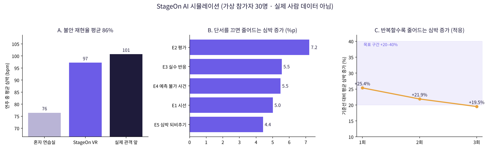

# StageOn AI 시뮬레이션 실험

> **이 결과는 실제 사람이 아니라 가상 참가자를 계산한 것입니다.** 실제 연주자의 반응을 보여 주지 않으며, 실제 사용자 실험이 필요합니다.

## 왜 하는가
1. 보고서의 실험 절차(조건 비교, 단서 끄기, 반복 노출)와 분석 방법이 실제로 돌아가는지 미리 확인한다.
2. 프로토타입의 실제 로직(`src/director.js`의 불안 조절 엔진·회복 판정, `src/config.js`의 수치)이 의도대로 동작하는지 본다.

## 방법
- 가상 참가자 30명. 참가자마다 안정 심박, 불안 특성, 단서별 민감도, VR 실재감 계수를 무작위로 정한다.
- 시나리오 “밴드 첫 클럽 공연”(Lv3, 18마디, 100 BPM)을 1초 단위로 계산한다.
- 조건: 혼자 연습실 / StageOn VR(조절 엔진 사용) / 실제 관객 앞(같은 단서를 실재감 계수 없이).

### 가정
| 항목 | 값 |
|---|---|
| 연주 동작에 의한 심박 증가 | +8% (모든 조건) |
| 단서별 기본 민감도 | E2 평가 0.16, E4 예측 불가 0.13, E3 실수 반응 0.12, E1 시선 0.10, E5 심박 되비추기 0.06 (평가·통제 불가가 가장 큰 스트레스라는 Dickerson & Kemeny(2004) 메타분석을 반영) |
| 불안 특성 | 평균 1.0, 표준편차 0.3 |
| VR 실재감 계수 | 0.65–0.95 |
| 실수 확률 | 마디당 4% × (1 + 각성도) |
| 반복 노출 적응 | 회차마다 새로움 효과 15% 감소 |

## 결과 (참가자 30명, 시드 42)
| 실험 | 결과 |
|---|---|
| A. 불안 재현율 | 연주 중 평균 심박: 연습실 76 · StageOn 97 · 실제 관객 101 bpm → 재현율 평균 **86%**(SD 9.6), 80% 이상 21/30명 |
| B. 단서별 기여도 | 단서를 껐을 때 줄어든 심박 증가: **E2 평가 7.2%p** > E3 실수 반응 5.5 ≈ E4 예측 불가 5.5 > E1 시선 5.0 > E5 심박 되비추기 4.4 |
| C. 적응 효과 | 같은 단계 반복 시 평균 심박 증가: 1회 +25.4% → 2회 +21.9% → 3회 +19.5% |
| 조절 엔진 | 목표 구간(+20–40%) 체류 시간: 엔진 사용 59% / 미사용 56% |

## 해석과 한계
- A의 재현율은 가정한 **VR 실재감 계수(평균 0.8)**와 조절 엔진이 추가한 장치에서 거의 그대로 나온다. 즉 “80%를 달성했다”는 근거가 아니라, 재현율을 계산하는 절차가 맞게 동작한다는 확인이다.
- B의 순서는 가정한 민감도 순서를 따른다. 실제 실험에서 이 순서가 바뀌면 개발 우선순위도 바뀐다.
- C는 가정한 적응률에서 나온다. 3회차에 목표 구간 아래로 내려가므로, 실제 훈련에서는 3회차부터 단계를 올려야 한다는 운영 기준을 얻었다.
- 조절 엔진의 효과(+3%p)는 작았다. 곡이 40초 남짓으로 짧아, 10초 미달 → 장치 추가 규칙이 몇 번 작동하지 못한다. 짧은 곡에서는 판단 시간을 줄이는 조정이 필요하다.
- **설계 수정:** 처음 설계의 회복 기준(기준선 +10% 이내로 8마디)은 무대 위 목표 구간(+20–40%)과 맞지 않아 시뮬레이션에서 회복이 한 번도 판정되지 않았다. 그래서 **“실수 직전 심박 수준 +5%p 이내로 돌아와 4마디 유지”**로 바꿨다.
